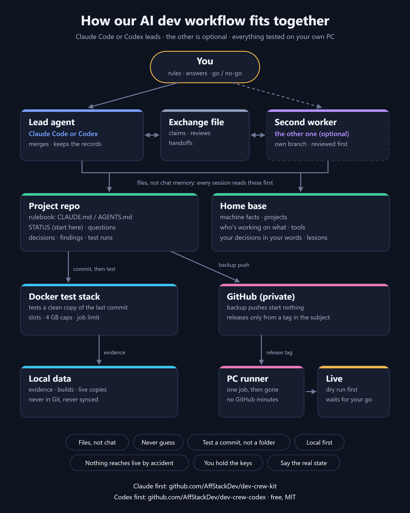
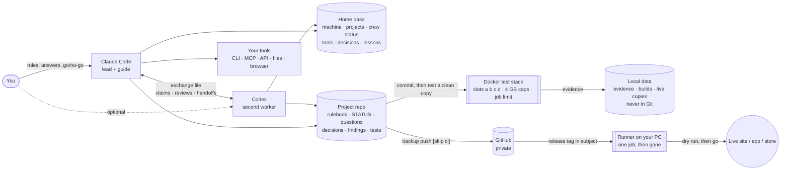

# Dev Crew

**A guided setup that turns your computer into a small, disciplined AI development shop:** Claude Code as the lead
developer, OpenAI's Codex as an optional second worker, Docker for testing on your own machine, Git for history,
GitHub for backup and releases, and your own tools (video editors, game engines, mobile SDKs, WordPress, design
tools, MCP connectors to your sites and services) wired into the same workflow.

You don't follow a long manual. You download this folder, open it in Claude, paste one line, and Claude walks you
through the whole setup one step at a time, checking each step on your computer before moving on.

→ **[Start here](START-HERE.md)**

---

## Why this exists

AI coding agents are capable, but out of the box they forget, guess, and step on each other:

- A long chat gets compacted and the rules you gave an hour ago are gone.
- "I fixed it" turns out to mean "I wrote something that might work".
- Two agents edit the same files; a background job overwrites another; a test passes because it ran on the wrong files.
- Tests and builds run in the cloud and burn minutes the computer could have done for free.
- A real email address ends up in public commit history; a token ends up in a log.

This kit is the cleaned-up version of a workflow built and used every day to run a live online store with more than a
dozen custom plugins: hundreds of local test runs, releases to a live site through rehearsed jobs, Claude and Codex working
side by side. Every rule in it is there because something went wrong without it.

## What you end up with

- **A home base**: one folder of notes every session and both agents read first: the machine's checked facts, your
  projects, who is working on what, your tools, and your decisions in your own words.
- **Rulebooks the agents actually follow**: global rules for Claude (`~/.claude/CLAUDE.md`) and Codex
  (`~/.codex/AGENTS.md`), plus one per project, all loaded automatically.
- **Records instead of chat memory**: a status page with "next session: start here", a numbered question list for
  decisions only you can make, a decision log, findings and test runs. Any new session picks up from the files.
- **A Docker test stack per project** that tests a clean copy of your last commit (never half-edited files), in
  parallel "slots", with memory caps and a job limit enforced by the helper script, and evidence for every run.
- **Git set up properly**: private email, line endings pinned, branches for every session, `main` moves only when you
  say.
- **GitHub as backup and release trigger, not a test farm**: backup pushes that start nothing, release jobs that run
  only when a commit's subject line says so, dry run first, optionally on a runner on your own computer so they cost
  no GitHub minutes.
- **Claude and Codex as a team** (optional): one exchange file per project, claims before edits, Codex works on its own
  branches, Claude reviews and tests Codex's work before anything is merged, Docker shared fairly.
- **Your other tools connected**: Claude asks what you use and wires each tool in the most reliable way available
  (CLI, MCP connector, API, files, browser, or screen control as a last resort), with guardrails you choose and a small
  real task as proof.
- **Phone access**: follow and steer sessions from the Claude app via Remote Control; review on GitHub mobile.

## How it fits together



<details>
<summary>The same diagram as text (Mermaid)</summary>



</details>

## Quick start

1. Install the Claude desktop app (claude.ai/download) and sign in. On Windows, also install Git for Windows.
2. Download this kit into a folder that isn't synced by OneDrive/iCloud/Dropbox (e.g. `C:\Users\<you>\GitHub\`).
3. Open the folder in the desktop app's **Code** tab and paste:

   ```text
   Set me up. Follow the Dev Crew playbook in this folder from the start, or resume where we left off. One step at a time, and check each step on my computer before moving on.
   ```

Full details, requirements and a fallback for people without Claude Code yet: **[START-HERE.md](START-HERE.md)**.

## What's in the kit

```
START-HERE.md      what you do yourself before Claude takes over
CLAUDE.md          tells Claude it's the setup guide here (loaded automatically)
AGENTS.md          the same note for Codex, if you open the folder there first
playbook/          the setup, step by step, written for Claude to follow (00 = how to guide, 01-15 = the steps)
recipes/           connecting common tools: WordPress/WooCommerce, MCP connectors, mobile, games/3D/characters,
                   video/audio, hosted stores, custom dev, desktop apps, data/AI
templates/         the files the setup creates: home base, global rules for Claude and Codex, project rulebook,
                   records, exchange file, Docker test stack, PC runner, workflows
scripts/           machine check, exchange watcher, setup check (read-only helpers)
my-setup/          created during setup: your progress file (git-ignored, survives kit updates)
```

## The ideas that make it work

1. **Files, not chat.** Anything that matters is written to a file when it happens. Agents re-read the files after a
   long task or a compaction instead of trusting memory.
2. **Never guess.** Check on the machine, read the official docs, or ask; say plainly what wasn't checked.
3. **Questions are batched, decisions are recorded.** The agents keep working and collect what only you can decide,
   with a recommended default. Your answers become numbered decisions, quoted in your words.
4. **Test a commit, not a folder.** Every test runs on a clean copy of a known commit, in Docker, with evidence.
5. **Local first.** Your computer does the testing and building; GitHub does what only GitHub can.
6. **Nothing reaches live by accident.** Release jobs start only from a tag in a commit's subject line, rehearse on a
   local copy first, dry run first, back up first, and wait for your go.
7. **You hold the keys.** Agents never type passwords, tokens or one-time codes, and never commit or print secrets.
8. **Say the real state.** Prepared, saved, delivered, verified and published are different things.
9. **Two agents, clear lanes.** Claims before edits, separate branches, one records writer, reviews before merges,
   fair sharing of the machine.

## Good to know

- **Tools change.** Install commands and settings were checked in November 2026. The playbook tells Claude to read each
  tool's current official docs before running its commands, and to follow them where they differ.
- **Codex is optional.** Everything works with Claude alone.
- **Costs are yours:** a Claude plan that includes Claude Code; optionally a ChatGPT plan with Codex; GitHub is free for
  private repositories within its limits; Docker Desktop is free for personal use, education and small businesses
  (check Docker's terms for larger companies).
- **Not affiliated** with Anthropic, OpenAI, Docker, GitHub or any tool vendor mentioned. Product names belong to their
  owners.

## License

[MIT](LICENSE): use it, copy it, change it, share it; keep the copyright notice.
